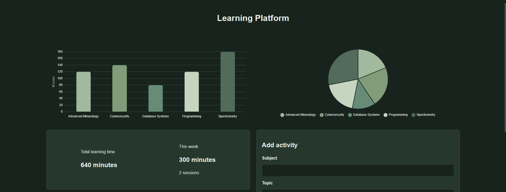
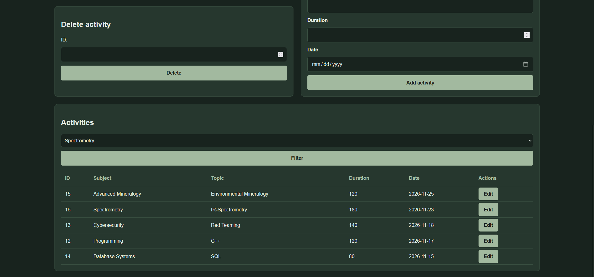

# Learning Platform
A web application for tracking learning activities, monitoring time spent on different subjects, and visualizing the progress.      
The Learning Platform allows users to record their sessions, organize them by subject, and keep track of their progress over time.

## Features
- **Activity tracking:** Record learning activities with a subject, topic, duration, and date. 
- **Activity management:** Add, edit, and delete learning activities. 
- **Subject filtering:** Filter recorded activities by subject. 
- **Learning statistics:** View total learning time and weekly statistics, including the number of sessions. 
- **Data visualization:** Visualize learning statistics using charts. 

## Tech Stack
- **Python** – Backend logic
- **Flask** – Web framework
- **SQLite** – Database
- **HTML** – Page structure
- **CSS** – Styling and layout
- **JavaScript** – Frontend functionality
- **Chart.js** – Data visualization

## AI Assistance
AI tools (ChatGPT) were used as a learning and development tool during this project, primarily for frontend implementation, including CSS styling and Chart.js configuration.  
The backend architecture, database functionality, application logic, and integration were developed and tested as part of my own learning process. AI-generated suggestions were reviewed, adapted, and tested before being incorporated into the project.

## Installation and Setup

### 1. Clone the repo
`git clone <https://github.com/sebastianrenk/learning_platform>
cd learning_platform`

### 2. Create and activate virtual environment
`python -m venv venv`

**For Windows:** 
`venv\Scripts\activate`
**For Linux/MacOS:**
`source venv/bin/activate`

### 3. Install dependencies
`pip install Flask`

### 4. Run the app
`python app.py`
**Then, open a browser and insert the url:** *http://127.0.0.1:5000*

## Project structure
`learning_platform/
│
├── (main.py)
├── app.py
├── tracker.py
├── database.py
│
├── database/
│   └── learning.db
│
├── static/
│   ├── css/
│   │   └── styles.css
│   └── js/
│       └── chart.js
│
├── templates/
│   ├── index.html
│   └── edit.html
│
├── images/
│
└── README.md`

## Status
Version 1.0

## Future improvements
- Testing (unit tests)
- Additional statistics and visualizations
- Improve filtering and sorting
- Let users create an account

## About
This project was developed as a personal programming project to practice Python and SQL, and explore frontend development.
